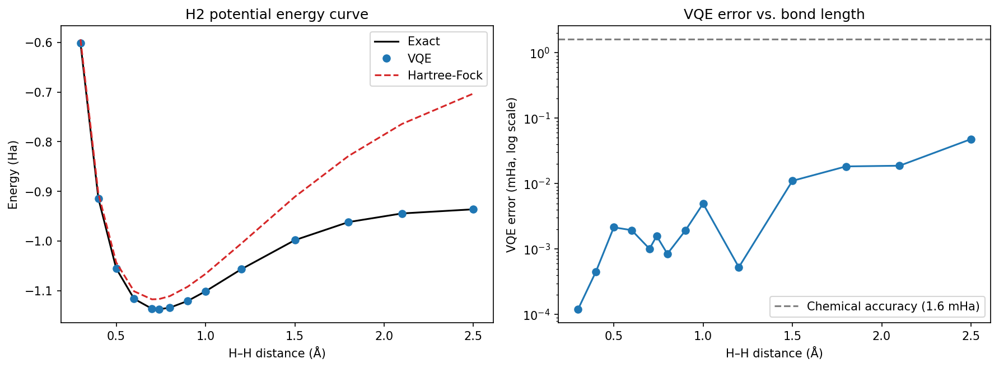
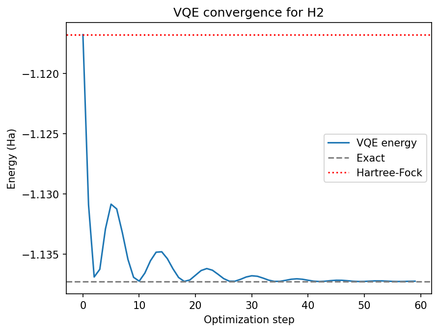

# Variational Quantum Eigensolver (VQE) for the H₂ Molecule: Potential Energy Curve

Ground-state energy of the hydrogen molecule computed with the Variational Quantum Eigensolver in [PennyLane](https://pennylane.ai/), benchmarked against exact diagonalization and Hartree-Fock across 14 bond lengths (0.3 to 2.5 Å).



## Summary

| Metric | Value |
|---|---|
| Qubits | 4 |
| Hamiltonian | 15 Pauli terms (STO-3G basis, Jordan-Wigner mapping) |
| Ansatz | `AllSinglesDoubles` (chemistry-inspired, 3 trainable parameters) |
| Equilibrium bond length (exact curve minimum) | 0.74 Å |
| Exact ground-state energy at 0.74 Å | -1.137286 Ha |
| Mean VQE error (14 distances) | 0.0080 mHa |
| Max VQE error (at 2.5 Å) | 0.0478 mHa |
| Chemical accuracy threshold | 1.6 mHa |

**Key findings**

- VQE reaches chemical accuracy at every bond length tested. The worst case is about 33 times below the 1.6 mHa threshold.
- Hartree-Fock is off by about 20.5 mHa at the equilibrium distance and by about 233 mHa at 2.5 Å, because mean-field theory cannot describe the stretched bond. VQE recovers this missing electron correlation energy.
- VQE error grows slightly with bond length (0.0001 mHa at 0.3 Å to 0.048 mHa at 2.5 Å). The likely cause is that the optimizer converges a little less tightly when correlation is stronger. This is an optimization effect, not a limitation of the ansatz.

## Method

1. **Hamiltonian.** The molecular Hamiltonian is built with `qml.qchem.molecular_hamiltonian` (STO-3G minimal basis) and mapped to 4 qubits, giving a sum of 15 Pauli terms.
2. **Reference energy.** The exact ground-state energy is the lowest eigenvalue from classical diagonalization of the Hamiltonian matrix. This is the ground truth for the chosen basis set.
3. **Initial state.** The circuit starts from the Hartree-Fock state `[1 1 0 0]`, the classical mean-field solution.
4. **Ansatz.** `AllSinglesDoubles` applies 2 single excitations and 1 double excitation, so the circuit has 3 trainable parameters, all initialized to zero (the energy at the start equals the Hartree-Fock energy).
5. **Optimization.** The circuit output is the energy expectation value ⟨H⟩. Adam (learning rate 0.1) minimizes it, using 60 steps for the single-geometry run and 80 steps per bond length for the curve. By the variational principle, the energy can never fall below the exact ground state, so lower always means closer.
6. **Potential energy curve.** The whole procedure is repeated at 14 H–H distances, recording exact, Hartree-Fock, and VQE energies.

## Results

### Convergence at equilibrium (0.74 Å)



Starting from the Hartree-Fock energy of -1.116770 Ha, VQE reaches -1.137262 Ha after 60 steps, which is 0.0239 mHa from the exact value of -1.137286 Ha. The damped oscillation in the plot is typical of Adam with a fairly large learning rate. It overshoots the minimum and then settles. A smaller learning rate or a decay schedule would smooth it.

### Potential energy curve

| H–H distance (Å) | Exact (Ha) | Hartree-Fock (Ha) | VQE (Ha) | HF error (mHa) | VQE error (mHa) |
|---|---|---|---|---|---|
| 0.30 | -0.601804 | -0.593828 | -0.601803 | 8.0 | 0.0001 |
| 0.40 | -0.914150 | -0.904361 | -0.914149 | 9.8 | 0.0005 |
| 0.50 | -1.055160 | -1.042996 | -1.055158 | 12.2 | 0.0021 |
| 0.60 | -1.116286 | -1.101128 | -1.116284 | 15.2 | 0.0019 |
| 0.70 | -1.136189 | -1.117349 | -1.136188 | 18.8 | 0.0010 |
| 0.74 | -1.137284 | -1.116759 | -1.137282 | 20.5 | 0.0016 |
| 0.80 | -1.134148 | -1.110850 | -1.134147 | 23.3 | 0.0008 |
| 0.90 | -1.120560 | -1.091914 | -1.120558 | 28.6 | 0.0019 |
| 1.00 | -1.101150 | -1.066109 | -1.101145 | 35.0 | 0.0049 |
| 1.20 | -1.056741 | -1.005107 | -1.056740 | 51.6 | 0.0005 |
| 1.50 | -0.998149 | -0.910874 | -0.998138 | 87.3 | 0.0110 |
| 1.80 | -0.961817 | -0.828848 | -0.961799 | 133.0 | 0.0183 |
| 2.10 | -0.944375 | -0.764178 | -0.944356 | 180.2 | 0.0188 |
| 2.50 | -0.936055 | -0.702944 | -0.936007 | 233.1 | 0.0478 |

## Repository contents

| File | Description |
|---|---|
| `VQE-H2.ipynb` | Full notebook: Hamiltonian, exact solution, VQE, potential energy curve |
| `vqe_convergence.png` | VQE energy vs. optimization step at 0.74 Å |
| `h2_potential_energy_curve.png` | Energy curve and VQE error vs. bond length |
| `README.md` | This file |

## How to run

```bash
pip install pennylane matplotlib numpy scipy
```

Open the notebook and run all cells. It also runs on Kaggle or Google Colab (add `!pip install pennylane` as the first cell). No GPU is needed, and the full curve takes a few minutes on a CPU.

## Limitations

- **Minimal basis set.** "Exact" means exact within STO-3G, so it is the best possible answer for this model of the molecule, not the experimental energy of real H₂.
- **Noiseless simulation.** All runs use a perfect state-vector simulator. Real hardware noise would degrade these results considerably.
- **A well-matched ansatz on a tiny problem.** For H₂ in a minimal basis, the single and double excitations can represent the exact ground state, so near-exact accuracy is expected. The results show the pipeline works correctly. They do not show an advantage over classical methods, which solve H₂ trivially.
- **Single run per geometry.** Each bond length was optimized once with a fixed learning rate and step count. Differences at the 0.001 mHa level are optimizer noise and should not be over-interpreted.

## Future work

- Compare ansätze (UCCSD-style vs. hardware-efficient) and optimizers (Adam, gradient descent, COBYLA, SPSA) over multiple seeds
- Add simulated hardware noise and apply error mitigation (for example, with Mitiq)
- Extend to LiH using a reduced active space
- Test learning-rate schedules to remove the late-stage oscillation

## Tech stack

Python · PennyLane (`qchem`) · NumPy · Matplotlib

## Author

Vignesh ([@Vignesh1056](https://github.com/Vignesh1056))
